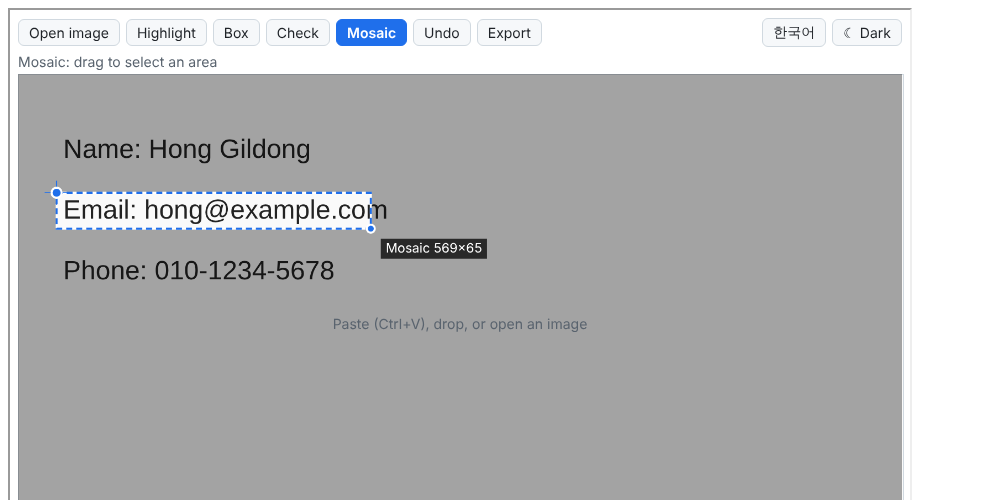

# 이미지 주석 (image-annotate-mcp)

AI 채팅 앱(Claude, ChatGPT) 안에서 [MCP App](https://github.com/modelcontextprotocol/ext-apps)으로 도는 작은 이미지 주석 도구입니다.
스크린샷을 붙여넣고 하이라이트, 네모, 체크, 모자이크, 가리기(불투명 상자)를 손으로 하거나 에이전트에게 말로 시킵니다("이메일 주소 모자이크해 줘").



## 설치

계정이나 로그인이 필요 없습니다. 주소: `https://image-annotate-mcp.vercel.app/mcp`

- **Claude** (웹, 데스크톱, 모바일): 설정 → 커넥터 → **사용자 지정 커넥터 추가** → 이름 `이미지 주석`, URL은 위 주소. 대화에서 **+** → 커넥터에서 켭니다.
- **ChatGPT**: 설정 → 앱 → 고급 설정에서 **개발자 모드**를 켜고, 위 주소로 앱을 만듭니다. 인증은 **없음**.
- **Claude Code**: `claude mcp add --transport http image-annotate https://image-annotate-mcp.vercel.app/mcp`
- **Codex 등 다른 MCP 클라이언트**: 원격(Streamable HTTP) MCP 서버로 추가합니다. 화면은 MCP Apps를 지원하는 앱에서만 보입니다.

안내: [image-annotate-mcp.vercel.app](https://image-annotate-mcp.vercel.app/#ko) · [개인정보처리방침](https://image-annotate-mcp.vercel.app/privacy#ko) · [이용약관](https://image-annotate-mcp.vercel.app/terms#ko) · [English README](README.md)

## 사용법

1. "이미지 주석 앱 열어 줘"라고 요청합니다.
2. 앱 안에서 스크린샷을 붙여넣거나(Ctrl+V / ⌘V), 끌어다 놓거나, 파일을 고릅니다.
3. 도구와 색상(모자이크는 강도)을 고르고 영역을 드래그합니다. 드래그하는 동안 영역이 미리 보입니다.
4. 또는 에이전트에게 "오류 메시지에 빨간 네모 쳐 줘"처럼 말합니다.
5. 내보내기로 PNG를 저장합니다. 되돌리기는 마지막 표시를 취소합니다.

비밀번호, 카드 번호 같은 민감한 정보는 **가리기**를 쓰세요. 모자이크는 일부 복원될 수 있습니다.

## 도구

| 도구 | 하는 일 |
| --- | --- |
| `open_annotator` | 주석 앱을 엽니다 |
| `apply_marks` | 에이전트가 정한 위치(이미지 픽셀 사각형)에 표시를 그립니다 |

## 개인정보

이미지는 이 서버로 올라가지 않습니다. 에이전트가 표시할 수 있도록 앱이 채팅 앱의 AI 모델에 이미지를 공유하며, 그 사본은 채팅 앱 제공자의 방침을 따릅니다.
에이전트 표시는 숫자(위치, 종류, 색상)로만 서버에 오고 저장되지 않습니다. 서버에는 데이터베이스가 없고 아무것도 보관하지 않습니다.
전체 방침: [개인정보처리방침](https://image-annotate-mcp.vercel.app/privacy#ko)

## 개발

```sh
npm install
npm test                    # UI 빌드, MCP 서버 검사, 브라우저 테스트(Playwright + Chromium 필요)
node test/listing-shots.cjs # 디렉터리용 스크린샷 docs/listing/*.png 생성
```

문의와 버그 신고: [GitHub Issues](https://github.com/hughqlee/image-annotate-mcp/issues)
