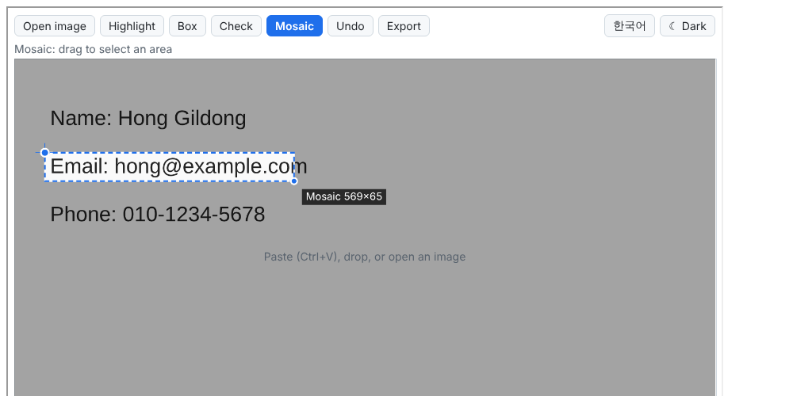

# image-annotate-mcp

A tiny image annotator that runs inside AI chat apps (Claude, ChatGPT) as an [MCP App](https://github.com/modelcontextprotocol/ext-apps).
Paste a screenshot, then highlight, box, check, mosaic or redact (solid box) parts of it — by hand or by asking the agent ("mosaic the email address").



## Install

No account or sign-in. Endpoint: `https://image-annotate-mcp.vercel.app/mcp`

- **Claude** (web, desktop, mobile): Settings → Connectors → **Add custom connector** → name `Image Annotate`, URL `https://image-annotate-mcp.vercel.app/mcp`. Then turn it on in a chat under **+** → Connectors.
- **ChatGPT**: Settings → Apps → Advanced settings → turn on **Developer mode**, then create an app with the MCP server URL above and authentication **None**.
- **Claude Code**: `claude mcp add --transport http image-annotate https://image-annotate-mcp.vercel.app/mcp`
- **Codex and other MCP clients**: add it as a remote (Streamable HTTP) MCP server. The interactive UI shows only in hosts that support MCP Apps.

Guide: [https://image-annotate-mcp.vercel.app](https://image-annotate-mcp.vercel.app) · [Privacy policy](https://image-annotate-mcp.vercel.app/privacy) · [Terms](https://image-annotate-mcp.vercel.app/terms) · [한국어 README](README.ko.md)

## How it works

- The image never leaves the browser. The user pastes (Ctrl+V), drops or picks it inside the app; the canvas does all the work.
  (MCP Apps has no standard way to hand chat attachments to an app yet, and this flow is more natural for screenshots anyway.)
- When an image is loaded, the app shares it with the model via `ui/update-model-context`.
- The agent calls `apply_marks` with pixel rectangles; the app draws them.
- Export goes through `ui/download-file` (sandboxed iframes cannot download directly).
- English / Korean and light / dark follow the host until the user toggles them.

## Tools

| Tool | Purpose |
| --- | --- |
| `open_annotator` | Opens the annotator UI |
| `apply_marks` | `{ marks: [{ type: "highlight" \| "rect" \| "check" \| "mosaic" \| "redact", x, y, w, h, color?, strength? }] }` in image pixels |

## Privacy

The image is never uploaded to this server. Inside the chat app, the app shares it with that app's AI model (via `ui/update-model-context`) so the agent can mark it;
the chat app's provider handles that copy under its own policy. Agent marks reach the server as numbers only (positions, types, colours) and are not stored.
The server has no database and keeps nothing. Full policy: [image-annotate-mcp.vercel.app/privacy](https://image-annotate-mcp.vercel.app/privacy).

## Develop

```sh
npm install
npm test          # builds the UI, checks the MCP server, runs the browser test (needs Playwright + Chromium)
```

`npm run build` bundles `src/ui.js` into a single HTML string at `lib/ui-html.js`, which `lib/server.js` serves as `ui://annotate/app.html`.

## Directory listing

- Public pages (guide, privacy, terms, icon) live in `site/` and are copied to `public/` by `npm run build`.
- Listing screenshots: `node test/listing-shots.cjs` writes `docs/listing/*.png` (PNG, 2000px wide, app area only).
- MCP Registry: `server.json` (`io.github.hughqlee/…`). `.github/workflows/publish-mcp.yml` publishes it (Actions → Run workflow, or push a `v*` tag).
  Keep the version in `server.json`, `package.json` and `lib/server.js` in step; the server test checks it.
- ChatGPT domain check: set the `OPENAI_APPS_CHALLENGE` environment variable in Vercel to the token from the OpenAI portal and redeploy;
  the build serves it at `/.well-known/openai-apps-challenge`.

## Deploy

Vercel: `api/mcp.js` exposes the server; `vercel.json` rewrites `/mcp` to it. Add `https://<your-deployment>/mcp` as a custom connector in Claude.

Open questions to check in real hosts: whether every host shows the `ui/update-model-context` image to the model, and whether agent marks land in the same app window (if a new one opens, the app restores the last image from `localStorage` for 30 minutes).
